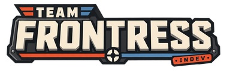

<h1 align="center">
  
</h1>

<h3 align="center">mm.team-frontress.org</h3>

The website of [Team Frontress](https://github.com/gru2007/team-frontress): the
admin panel of the Frontress game coordinator, and where players see their
accounts. It is built on [tf2pickup.org](https://github.com/tf2pickup-org/tf2pickup)
and keeps its look; the pick-up system itself is gone.

## What it is

Matches are found in the game. The game coordinator (`services/gc` in
team-frontress) forms the teams, runs the server pool and keeps every record:
players, matches, bans, reports, payments. This site keeps nothing of its own
— no database. Every page asks the coordinator when it is opened, and every
admin action is a call to the coordinator's admin API, recorded there with the
admin's SteamID and a reason.

| Page                                                                                                             | From the coordinator                                                                                                                 |
| ---------------------------------------------------------------------------------------------------------------- | ------------------------------------------------------------------------------------------------------------------------------------ |
| `/`, `/games`, `/games/:id`                                                                                      | `/v1/status`, `/v1/matches`, `/v1/matches/{id}`                                                                                      |
| `/players`, `/hall-of-fame`                                                                                      | `/v1/players`                                                                                                                        |
| `/players/:steamId`                                                                                              | `/v1/player/{id}`, `/v1/matches?steam_id=`                                                                                           |
| own profile: account                                                                                             | `/admin/v1/anticheat/{id}`, `/v1/player/{id}/quests`, orders                                                                         |
| `/players/:steamId/edit/bans`                                                                                    | `/admin/v1/anticheat/{id}` (ban, lift, Steam ban)                                                                                    |
| `/players/:steamId/edit/reports`                                                                                 | `/admin/v1/reports/{id}` (ban, dismiss)                                                                                              |
| `/admin/game-servers`, `/admin/games`                                                                            | `/admin/v1/live`; force-end: `/admin/v1/matches/{id}/end`                                                                            |
| `/admin/reports`                                                                                                 | `/admin/v1/reports`                                                                                                                  |
| `/admin/player-restrictions`                                                                                     | `/admin/v1/anticheat`                                                                                                                |
| `/admin/payments`                                                                                                | `/admin/v1/payments` (refund, cancel renewal)                                                                                        |
| `/admin/games`, `/admin/map-pool`, `/admin/player-restrictions`, `/admin/miscellaneous`, `/admin/view-for-nerds` | `/admin/v1/settings`: queues, maps, restrictions, chat, regions and ping, Easy Anti-Cheat, deadlines, webhooks, raw JSON and history |
| `/admin/game-servers` (keys)                                                                                     | `/admin/v1/server-keys` (create, rotate, revoke)                                                                                     |
| `/admin/logs`                                                                                                    | `/admin/v1/journal`: what the GC logged per player, server, match                                                                    |

Settings are changed by super users; moderators see them read-only. A save
goes to the coordinator, which validates it, applies it at once and keeps it
in its `data/settings.json` (over `gc.json`) with a history of who changed
what.

Players sign in through Steam. The session is an encrypted cookie with the
SteamID, the Steam name and the avatar. Who is an admin comes from `ADMINS`
and `SUPER_USERS`; the coordinator trusts this site's admin key, so keep the
key on this server only. Rules and the privacy policy are
`src/documents/default/*.md`.

## Running it

```bash
pnpm install
cp sample.env .env   # set GC_URL, GC_ADMIN_KEY, SESSION_SECRET, ADMINS
pnpm dev             # http://localhost:3000
```

A coordinator to work against: `go run ./cmd/frontress-gc -config gc.json` in
team-frontress `services/gc` with `auth.mode` `dev` and an `admin_key`.

Docker: `docker compose up -d --build` with the same `.env`.

`pnpm lint`, `pnpm test`, `pnpm build`.
